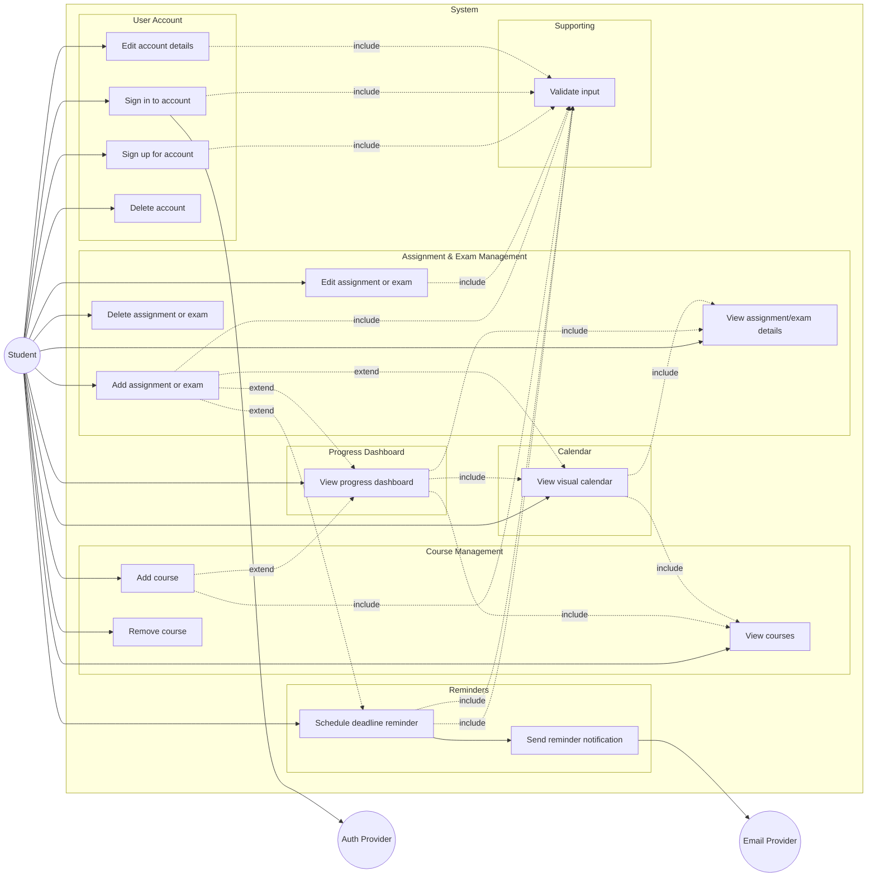
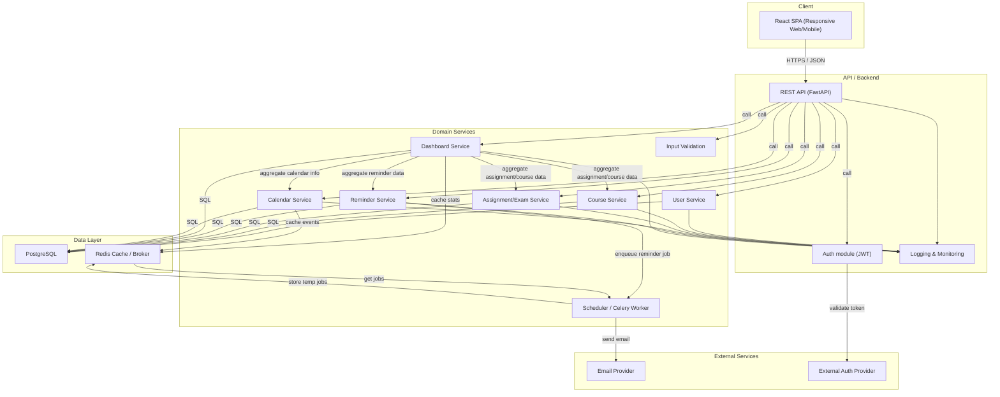
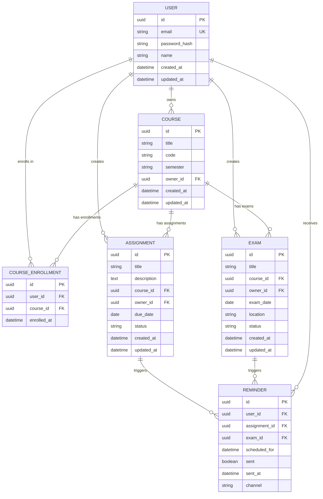
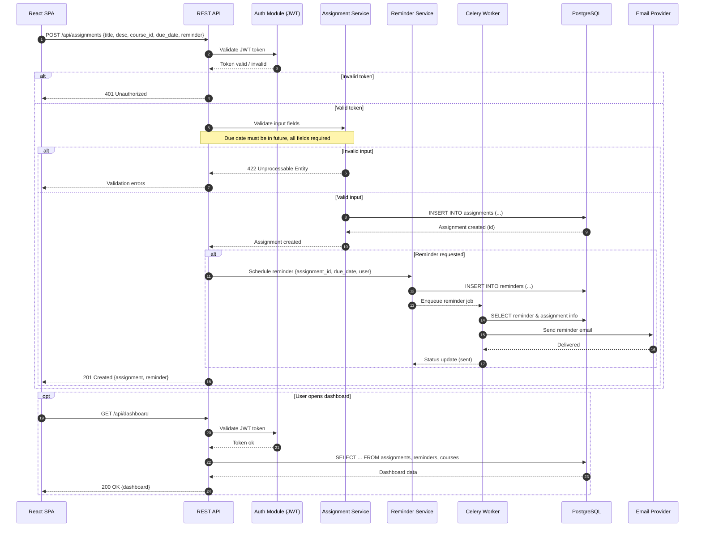

# Student Assignment and Exam Organizer

> Your essential tool for managing courses, assignments, and exams with ease.

A low-fidelity prototype of **Student Assignment and Exam Organizer**, generated by an agentic AI project manager from a stakeholder conversation in Slack.

## Screens

- [Home](index.html) — Introduction to the platform and navigation to its main features.
- [Course Management](courses.html) — Allows students to add and manage their courses.
- [Assignment Tracking](assignments.html) — Enables students to create and manage assignments with due dates.
- [Calendar Integration](calendar.html) — Displays all upcoming assignments and exams in a visual format.
- [Progress Dashboard](dashboard.html) — Shows pending tasks, completed tasks, and upcoming deadlines for students.
- [User Accounts](user.html) — Allows students to create and manage their individual accounts.

## What this prototype fakes

- This prototype uses Tailwind CSS for styling and is fully functional as a clickable prototype.
- All pages have consistent navigation and header functionality.
- All featured pages provide necessary interactions but do not connect to a backend service.
- User authentication and data persistence are simulated with buttons and static content.

## System design

### Student Assignment & Exam Organizer – Use Case Diagram

This use case diagram illustrates how the single actor, the Student, interacts with the core functions of the system grouped by feature areas: User Account, Courses, Assignments & Exams, Calendaring, Progress Dashboard, Reminders, and Task Updates. External systems for authentication and email delivery are represented as separate actors. Each bubble inside the system boundary is a use case derived from functional requirements, such as creating an account, adding courses, scheduling assignments/exams, editing tasks, viewing the dashboard, and receiving reminders. Supporting use cases like sign-in and validation are linked using 'include' relationships. Dotted 'extend' edges indicate optional flows such as triggering reminders when deadlines are near. The separation into nested subgraphs clarifies feature ownership and dependencies.

### System Architecture: Student Organizer Platform

This architecture diagram breaks the system into distinct technology-driven layers: Client (responsive React SPA for mobile/desktop), API (FastAPI REST backend handling HTTP/JSON), Domain Services (user, course, assignment, reminder, calendar, dashboard), Data (PostgreSQL, Redis), and External Services (auth and email providers). Core feature modules are drawn as individual backend components, matching the major product requirements. Authentication, monitoring/logging, and asynchronous reminder dispatch via Celery/Redis are all visible, showing a production-grade stack. All major data and request flows (HTTPS, SQL, background jobs) are labeled, making dependencies and points of integration clear.

### Entity Relationship Diagram: Student Organizer

The ERD captures all persistent entities supporting the platform's features: USER accounts, COURSEs, ASSIGNMENTs, EXAMs, and REMINDERs. A join table, COURSE_ENROLLMENT, models which users have added which courses. Assignments and exams both link to courses, and reminders are tied to assignments and exams. Attributes are typed and marked for uniqueness (UK), primary (PK) or foreign keys (FK). The diagram shows key relationships (such as a USER 'owns' many ASSIGNMENTs, each ASSIGNMENT belongs to a COURSE, and REMINDERs are associated with tasks), aligning with tracking and notification requirements. Timestamp fields support dashboard and calendar features.

### Sequence Diagram: Add Assignment with Reminder (Student Flow)

This sequence diagram traces the end-to-end flow when a student adds a new assignment with a deadline, requesting reminder notifications. The flow starts at the Web UI and proceeds through REST API authentication and input validation, persists the assignment, and schedules a reminder as a background job. The process includes an alt block for input error or authentication failure (with appropriate error responses). Note over relevant steps highlights business rules like 'due date must be in future' and that reminders are only scheduled if requested. The background worker is responsible for sending reminder emails using the external provider, completing the loop. This flow touches all major moving parts: UI, API, domain services, backend jobs, DB, and external integrations.

## Running it

Every file is static. Open `index.html`, or serve the directory with any static file server.
